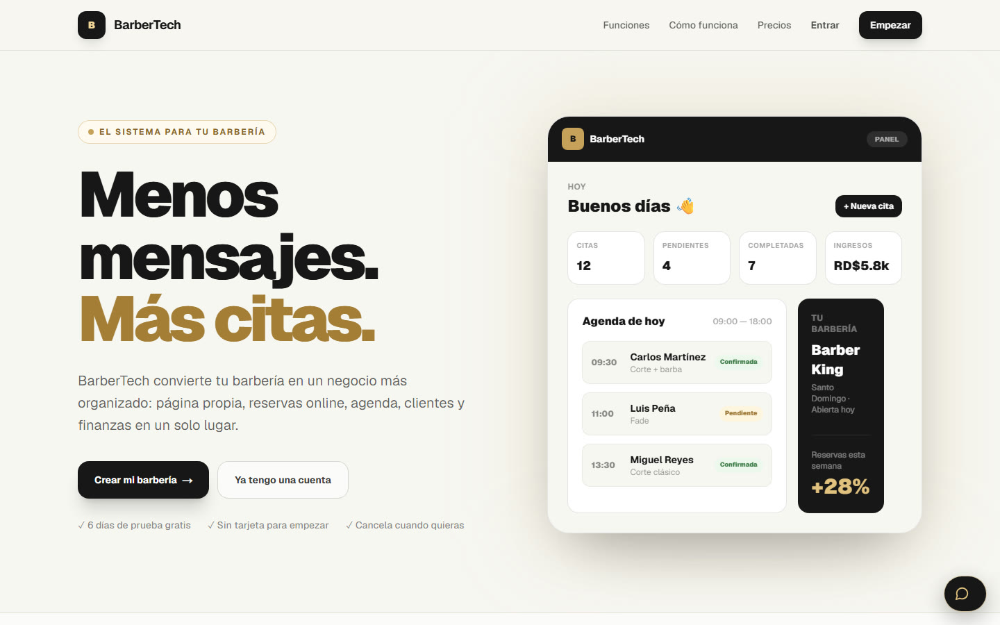
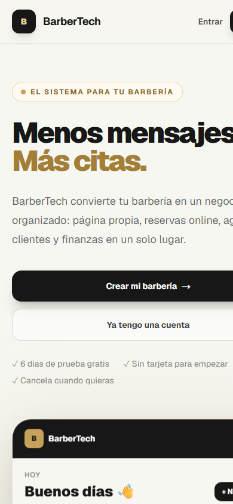

<div align="center">

# BarberTech

**Menos mensajes. Más citas.**

El sistema para tu barbería: página propia, reservas online, agenda, clientes y finanzas en un solo lugar.

[**barbertech.site →**](https://barbertech.site)



</div>

## Qué es

BarberTech es un SaaS para barberías. Cada barbería crea su cuenta y recibe su **página pública de reservas** (`barbertech.site/<su-barbería>`), donde sus clientes eligen servicio, barbero y hora sin escribir por WhatsApp. El dueño y sus barberos manejan todo desde un panel: la agenda del día, los clientes, los ingresos y las estadísticas del mes.

## Lo que hace

- **Página propia por barbería** con su color, portada, redes y nota de reserva.
- **Reservas online** con un motor de disponibilidad por barbero, servicio y horario.
- **Agenda en tiempo real:** las citas nuevas aparecen al instante, con botones de respuesta inmediata.
- **Notificaciones:** campanita en vivo, **Web Push** al teléfono del barbero y aviso al cliente por WhatsApp.
- **Equipo:** el dueño invita barberos por correo, cada uno con su rol y sus servicios.
- **Finanzas y estadísticas** mensuales, exportables a **Excel y PDF**.
- **PWA:** se instala en el teléfono o la computadora sin tienda de apps.
- **Suscripción** con prueba gratis, políticas de compra, activación, garantía y reembolso.

## Ingeniería

- **Multi-tenant** con `tenant_id` en cada tabla y **RLS de PostgreSQL** en todas las tablas de negocio. El tenant nunca se toma de lo que manda el cliente.
- **Límite de intentos** en el flujo público de reservas, por teléfono y por IP, hecho en Postgres sin servicios de pago.
- **Cabeceras de seguridad HTTP** y revisión de contraseñas filtradas sin depender de planes de pago.
- **Pruebas:** unitarias con Vitest y de integración contra las políticas RLS reales (`npm run test:integration`).
- Todas las decisiones de diseño están documentadas en [ARCHITECTURE.md](ARCHITECTURE.md).

<div align="center">

</div>

## Cómo está hecho

| Parte | Tecnología |
|---|---|
| Aplicación | Next.js 16 (App Router), React 19, TypeScript |
| Estilos | Tailwind CSS 4 |
| Datos | Supabase: PostgreSQL con RLS, Auth, Storage y Realtime |
| Avisos | Web Push (VAPID) |
| Documentos | pdf-lib |
| Pruebas | Vitest |
| Publicación | Vercel |

## Correrlo

```bash
npm install
cp .env.example .env.local   # pon tus llaves de Supabase y VAPID
npm run dev
```

Las migraciones de la base están en `supabase/migrations/`.

---

<div align="center">

Diseño y desarrollo: **Albert Silvestre** · [Portafolio](https://github.com/SrAlbert22)

</div>
